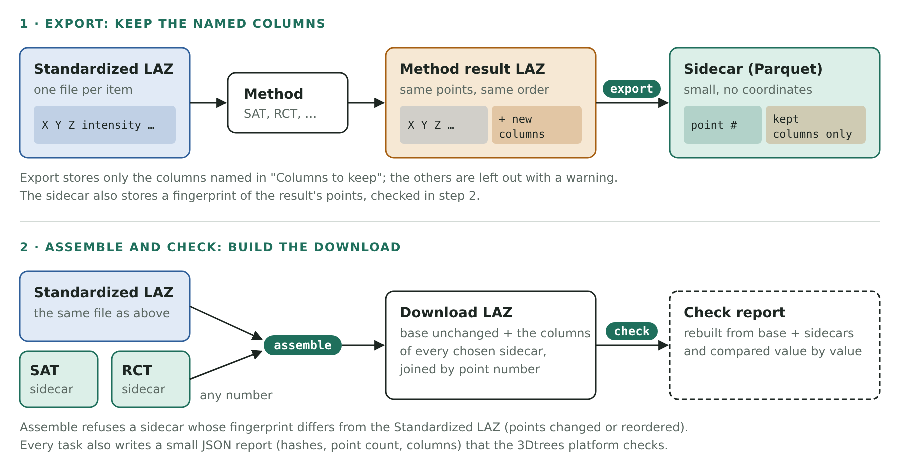

# 3Dtrees Sidecar

Galaxy tool for the 3Dtrees.earth processing pipeline. It moves the point-cloud
work that follows the scientific models into Galaxy: storing each method's
results as a small indexed column file ("sidecar"), building the downloadable
point cloud, and checking it independently.



| Task | Inputs (one item) | Outputs |
| --- | --- | --- |
| `export` | method output LAZ, the columns to keep | sidecar Parquet, JSON report |
| `assemble` | standard base LAZ, any selection of sidecars (SAT, ForestMamba, species) | downloadable LAZ, JSON report |
| `check` | the published base, sidecars and downloadable LAZ | JSON check report |

- **export** reads only the method output and writes `point_index` plus the
  columns named in `--columns`, for example SAT's two columns, a species output's
  own columns, or one method's columns from a combined legacy file. Columns of
  the output that are not named are printed as a warning and listed under
  `dropped` in the report. The sidecar records a fingerprint of the output's
  points (`points_sha256`: header, CRS and every standard point field, in order).
- **assemble** keeps every base field unchanged and in order and adds the
  selected sidecars' columns. It refuses a sidecar whose fingerprint differs from
  the base, so a method that reordered, dropped or changed points is caught.
  Any subset is valid (points only, one method, all). Sidecars in point order
  stream in constant memory.
- **check** rebuilds the point cloud from base and sidecars and compares every
  dimension point by point.

Every task writes a JSON report with identities, point count, dimensions and
SHA-256 hashes, so the 3Dtrees worker verifies stored bytes without downloading
point clouds. On 85 M points (10 cores) the first version took export 20 s,
assemble 35 s, check 62 s, each under 0.6 GB of memory and without temporary
disk; the fingerprint adds one read pass to export and assemble (about 25 % on
10 M points).

## Usage

```sh
python src/run.py export   --generation <uuid> --item <id> --enriched sat.laz --columns PredInstance_SAT,PredSemantic_SAT --output sat.parquet --report sat.json
python src/run.py assemble --base base.laz --generation <uuid> --item <id> --sidecar sat.parquet --output member.laz --report member.json
python src/run.py check    --base base.laz --generation <uuid> --item <id> --sidecar sat.parquet --member member.laz --report check.json
```

## Development

```sh
pip install -r requirements-dev.txt
python -m pytest -q tests
docker build -t ghcr.io/3dtrees-earth/3dtrees_sidecar:dev .
```

## Release

Bump `VERSION` in `src/run.py`, merge, and publish a GitHub release `v<version>`.
The release workflow checks the tag against `VERSION` and pushes
`ghcr.io/3dtrees-earth/3dtrees_sidecar:<version>`. The Galaxy wrapper lives in
[galaxytools](https://github.com/bgruening/galaxytools) under
`tools/3dtrees_sidecar` and pins the same version.
